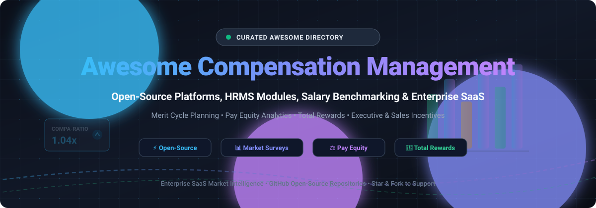

# Awesome Compensation Management 💼 📈

  

  
  
  
  
  
  

---

## 🌟 Overview & Highlights

A comprehensive, curated directory of **Compensation Management Software**, **Total Rewards Platforms**, **Salary Benchmarking Tools**, **Pay Equity Analytics Suites**, and **Self-Hosted Open-Source HRMS Payroll Solutions**. 

Whether you are a **Chief People Officer (CPO)**, **Total Rewards Director**, **HR Operations Lead**, or **Software Engineer** architecting custom HR tech stacks, this resource maps out industry leaders, pricing models, free tiers, and open-source infrastructure.

* 🎯 **Merit & Bonus Cycle Planning**: Streamline annual salary increments, promotion budgets, and manager discretion modeling.
* 📊 **Market Salary Benchmarking**: Real-time salary survey intelligence, compa-ratio calculations, and market percentiles (P25, P50, P75, P90).
* ⚖️ **Pay Equity & Compliance**: Address pay gap audits (gender, ethnicity), EU Pay Transparency Directive readiness, and US state-level salary transparency mandates.
* 💎 **Total Rewards Statements**: Dynamic visualization of base pay, health benefits, variable bonuses, 401(k) matching, and equity (RSUs/options).
* 🔓 **Open-Source Infrastructure**: Self-hosted repositories for developers seeking full data ownership and customizable payroll/salary architectures.

---

## 📑 Table of Contents

- [🌐 Sector Overview & Market Dynamics](#-sector-overview--market-dynamics)
- [🏢 SaaS & Enterprise Hosted Platforms](#-saas--enterprise-hosted-platforms)
- [⚡ Open-Source GitHub Projects](#-open-source-github-projects)
- [🛠️ Architecture & Implementation Guide](#️-architecture--implementation-guide)
- [🤝 How to Contribute](#-how-to-contribute)
- [💖 Support & Sponsorship](#-support--sponsorship)
- [📈 Star History](#-star-history)
- [⚠️ Disclaimer](#️-disclaimer)

---

## 🌐 Sector Overview & Market Dynamics

The global compensation management software market is estimated at **$5.07B to $5.74B** (with the broader global payroll and total rewards software ecosystem exceeding **$28B+**), expanding at an estimated compound annual growth rate (CAGR) of **10%–13%**. 

The sector is **moderately fragmented**: mega-cap enterprise Human Capital Management (HCM) conglomerates (**Oracle**, **SAP**, **Workday**) capture high-volume multi-module enterprise accounts, but cannot build a winner-take-all monopoly. A robust ecosystem of specialized, best-of-breed point solutions (**Payscale**, **Salary.com**, **Beqom**, **Lattice**) thrives by providing dedicated proprietary salary survey benchmarking datasets, automated pay equity compliance analytics, and complex variable/equity incentive cycle modeling that monolithic ERP suites often lack.

---

## 🏢 SaaS & Enterprise Hosted Platforms

The table below outlines leading commercial platforms, ranked descending by estimated company revenue and enterprise valuation.

| 🏢 Platform | 💰 Revenue / Valuation (Descending) | 🏷️ Specific Pricing Starting Tier | 🎁 Free Tier & Trial Limits | 🎯 Key Highlights & Best For |
| :--- | :--- | :--- | :--- | :--- |
| **[Oracle Fusion HCM Compensation](https://www.oracle.com/human-capital-management/)** | ~$53B ARR / ~$450B+ Market Cap | Achievable net rates of **$11–$16/employee/month** (1,000–5,000 employees; scales down to $5.50–$9 for 25,000+ employees) within HCM Enterprise bundle. | **No free tier** for HCM application; 30-day trial with $300 cloud credits limited to underlying OCI infrastructure testing. | Best for Oracle Cloud HCM customers seeking unified compensation, talent, and core HR. |
| **[SAP SuccessFactors Compensation](https://www.sap.com/products/hcm/compensation-management.html)** | ~€31B ARR (~$34B) / ~$240B+ Market Cap | Starts at approximately **$4.00–$8.50/user/month** (bundled multi-module agreements yield 15%–28% discounts; typically sold under annual agreements). | **30-day free trial**; access limited to a shared sandbox environment with pre-populated demo data and guided evaluation tours. | Best for SAP-centric global enterprises integrating merit planning with core HR. |
| **[Workday Compensation](https://www.workday.com/)** | ~$7.3B ARR / ~$65B+ Market Cap | Starts at **$18–$42/employee/year** base compensation module ($1.50–$3.50/employee/month), plus $6–$22/employee for sales/equity add-ons; $140,000+ typical implementation. | **No free tier** or trial for Workday HCM/Compensation (only Workday Adaptive Planning offers a separate 30-day trial). | Best for large enterprises already on Workday wanting compensation connected to talent analytics. |
| **[Lattice](https://lattice.com/)** | ~$130M ARR / $3.0B Valuation | Base platform starts at **$13/seat/month**, plus **$6/seat/month** for the Compensation add-on module ($19/seat/month total; minimum annual commitment of $4,000). | **No free tier** or free trial; platform evaluation is available solely via scheduled sales walkthroughs. | Best for organizations running performance management on Lattice looking for tightly linked merit cycles. |
| **[Culture Amp](https://www.cultureamp.com/)** | ~$200M ARR / $1.5B Valuation | Median observed contract value starting around **$23,400/year** (approximately $7–$12/employee/month at mid-market volumes plus 10%–25% onboarding). | **No free tier** or free trial; product demonstrations and guided evaluations require sales approval. | Best for organizations prioritizing employee engagement and feedback-driven compensation cycles. |
| **[Payscale](https://www.payscale.com/)** | ~$175M ARR / ~$800M+ PE Backing (Francisco Partners) | **$12,000–$35,000/year** for MarketPay entry-tier (200–1,000 employees); Insight Lab ranges $40,000–$90,000/year. | **Payfactors Free Tier**: Limited to pricing individual benchmark jobs in the US & Canada; expires after 1 year or 90 consecutive days of inactivity. | Best for HR teams needing comprehensive market salary benchmarking data, job architectures, and pay equity tools. |
| **[Salary.com CompAnalyst](https://www.salary.com/)** | ~$80M ARR / ~$400M+ PE Backing (Accel-KKR / H.I.G.) | Starts in the **low-to-mid five figures ($15,000–$30,000/year)** for small/mid-market CompAnalyst deployments; up to $100,000+ for enterprise. | **14-day free trial**; limited specifically to CompAnalyst Market Data benchmarking lookups (no credit card required). Full software suite requires quote. | Best for compensation analysts requiring granular salary survey data and pay equity compliance. |
| **[Beqom](https://www.beqom.com/)** | ~$40M ARR / ~$500M+ PE Backing (Sumeru Equity) | Quote-only enterprise plans starting at approximately **CHF 50,000/year (~$55,000/year)** or ~$150/user/month depending on scope. | **No free tier** or self-service trial; evaluation is strictly handled through customized enterprise proof-of-concept demos. | Best for large multinational corporations with complex variable pay, sales incentives, and LTI structures. |
| **[Decusoft Compose](https://www.decupsoft.com/)** | ~$15M ARR / Private (FINTOP Capital) | Starting tier estimates from **$2.00–$5.00/user/month** for planning modules, or custom enterprise annual license averaging $20,000–$50,000/year. | **No free tier** or public free trial; evaluation is restricted to custom vendor-led demonstrations. | Best for dedicated variable compensation, merit cycles, and bonus allocation without full HRIS replacement. |
| **[CompXL](https://compxl.com/)** | ~$10M ARR / Acquired by Salary.com | Third-party benchmarks list starting pricing at **$35/employee/month** (or ~$10,000–$25,000 annual minimum depending on employee count). | **No free tier** or free trial; access requires a vendor sales consultation and guided demo. | Best for mid-sized organizations seeking spreadsheet-like flexibility in merit, bonus, and incentive cycle planning. |

---

## ⚡ Open-Source GitHub Projects

The following open-source repositories provide foundational code, HRMS modules, salary calculation engines, equity structures, and analytics scripts. Repositories are sorted in **descending order by GitHub Stars_Count**.

- **[Odoo](https://github.com/odoo/odoo)** 
  
  **Open-source ERP suite with HR, Payroll & Contract modules** (LGPL-3.0). Includes employee contract definitions, base wage setting, allowance/deduction components, and automated payroll execution. Community edition provides core pay structures, while third-party apps extend it to merit matrices.
  * **Tech stack**: Python, JavaScript, PostgreSQL
  * **License**: LGPL-3.0 | **Deploy**: Self-hosted, Docker, Odoo Cloud
  * **Best for**: Businesses seeking an integrated ERP with configurable compensation and payroll backbones.

- **[Open Guide to Equity Compensation](https://github.com/jlevy/og-equity-compensation)** 
  
  **Comprehensive open reference and analysis for equity compensation** (stock options, RSUs, vesting schedules, AMT, 83(b) elections, and taxes). The definitive developer and founder guide to startup total compensation modeling.
  * **Tech stack**: Markdown, MathJax
  * **License**: CC-BY-SA-4.0
  * **Best for**: Founders, HR leaders, and engineers evaluating or designing total equity reward programs.

- **[Frappe HR](https://github.com/frappe/hrms)** 
  
  **Open-source HR and Payroll engine** (GPL-3.0) for Frappe and ERPNext. Features robust **Salary Structure** assignments, formula-based earning/deduction components, multi-currency payroll, tax bracket formulas, and automated payslip generation.
  * **Tech stack**: Python (Frappe Framework), Vue.js, MariaDB
  * **License**: GPL-3.0 | **Deploy**: Self-hosted or Frappe Cloud
  * **Best for**: Organizations requiring customizable salary rules, tax deductions, and payroll infrastructure.

- **[Gauzy](https://github.com/ever-co/gauzy)** 
  
  **Open-source business management and ERP software** designed for modern agencies, remote teams, and enterprises. Features employee contracts, hourly wage tracking, bonus accounting, payroll processing, and time-tracking compensation integration.
  * **Tech stack**: TypeScript, NestJS, Angular, TypeORM
  * **License**: AGPL-3.0 | **Deploy**: Docker, Kubernetes, Cloud
  * **Best for**: Tech consultancies and remote-first organizations managing distributed workforce compensation.

- **[Horilla HRMS](https://github.com/horilla-opensource/horilla)** 
  
  **Free and open-source Human Resource Management software** built with Python and Django. Offers comprehensive employee management, allowances/deductions configuration, salary batch processing, and contract lifecycle workflows.
  * **Tech stack**: Python, Django, HTML5/CSS3
  * **License**: LGPL-3.0 | **Deploy**: Self-hosted, Docker
  * **Best for**: SMBs looking for a clean, extensible Django-based HR platform with compensation modules.

- **[OrangeHRM](https://github.com/orangehrm/orangehrm)** 
  
  **Open-source HR management system** (GPL-3.0) providing basic salary administration, pay grade bands, currency assignments, direct deposit specifications, and employee compensation history logs.
  * **Tech stack**: PHP, Symfony, MySQL
  * **License**: GPL-3.0 | **Deploy**: Self-hosted, LAMP, Docker
  * **Best for**: Small-to-mid HR teams requiring structured pay grade records within a classic HRMS environment.

- **[Comp Band Analyzer (Claude-Skills)](https://github.com/borghei/Claude-Skills)** 
  
  **Python script and agent skill for pay band health and pay equity analysis**. Computes compa-ratios against job ranges, detects pay disparity outliers, flags comp anomalies, and suggests merit budget allocations.
  * **Tech stack**: Python, Pandas
  * **License**: MIT
  * **Best for**: People analytics teams and HR analysts needing quick, modular audit scripts for compa-ratios.

- **[IceHrm](https://github.com/gamonoid/icehrm)** 
  
  **Modular open-source HR management platform** (Apache-2.0). Provides salary components configuration, basic payroll processing, department compensation summaries, and employee expense claims.
  * **Tech stack**: PHP, AngularJS, MySQL
  * **License**: Apache-2.0 | **Deploy**: Self-hosted, Docker
  * **Best for**: Companies seeking a permissive Apache-2.0 licensed HR base for employee salary tracking.

- **[Tax-Calculator](https://github.com/PSLmodels/Tax-Calculator)** 
  
  **Open-source Federal Individual Income and Payroll Tax Microsimulation Model** (PSL). Simulates US federal tax liabilities, FICA payroll taxes, and net take-home pay under existing tax law and reform proposals.
  * **Tech stack**: Python, NumPy, Pandas
  * **License**: CC0-1.0
  * **Best for**: Quantitative compensation analysts modeling gross-to-net take-home pay and tax impact of executive bonus/equity payouts.

- **[Aragon Payroll App](https://github.com/1Hive/payroll-app)** 
  
  **Decentralized streaming salary and compensation smart contracts** for DAOs and Web3 organizations. Supports tokenized compensation streams, recurring wage distributions, and deferred compensation agreements.
  * **Tech stack**: Solidity, JavaScript, AragonOS
  * **License**: GPL-3.0
  * **Best for**: Web3 protocols and decentralized autonomous organizations (DAOs) automating continuous token compensation.

- **[PaySQL (SalaryManagementSystem)](https://github.com/nowshad7/SalaryManagementSystem)** 
  
  **Relational database payroll and compensation management engine** written in Oracle PL/SQL. Handles employee records, allowances, overtime rules, provident funds, income tax slabs, and pay-run cycles.
  * **Tech stack**: Oracle PL/SQL, SQL
  * **License**: Open Source
  * **Best for**: Database architects seeking pure SQL/stored-procedure logic for salary calculations.

- **[CommissionPro](https://github.com/Estevan-Z/CommissionPro)** 
  
  **Lightweight sales commission tracking tool** (Django/Python). Configures commission percentages, sales performance tiers, and incentive payout calculations.
  * **Tech stack**: Python (Django), SQLite
  * **License**: Open Source
  * **Best for**: Small sales operations needing dedicated commission calculation logic.

- **[FairPay](https://github.com/kcngkc/FairPay)** 
  
  **Autonomous AI HR compensation benchmarking agent**. Demonstrates integration between BigQuery, US Bureau of Labor Statistics (BLS OEWS) wage surveys, LLM analysis, and compa-ratio variance alerting.
  * **Tech stack**: Python, Google Cloud BigQuery, Gemini AI
  * **License**: MIT
  * **Best for**: AI developers looking for proof-of-concept architectures for automated market comp matching.

---

## 🛠️ Architecture & Implementation Guide

When assembling a modern compensation management technology stack:

1. **Strategic Decision Layer (Market Benchmarking & Pay Equity)**:
   * SaaS solutions like **Payscale**, **Salary.com**, or **Beqom** provide proprietary data networks that open-source tools cannot replicate out-of-the-box.
   * Open-source alternatives (like **[Comp Band Analyzer](https://github.com/borghei/Claude-Skills)** and **[FairPay](https://github.com/kcngkc/FairPay)**) provide transparent calculation formulas for compa-ratios and internal equity audits.
2. **Execution & Operational Layer (Payroll & Salary Structures)**:
   * Self-hosted systems like **[Frappe HR](https://github.com/frappe/hrms)** or **[Odoo](https://github.com/odoo/odoo)** provide enterprise-grade database models for earnings, deductions, bonuses, and tax compliance.
3. **Total Rewards & Equity Architecture**:
   * Refer to the **[Open Guide to Equity Compensation](https://github.com/jlevy/og-equity-compensation)** to establish clean vesting schedules, cliff rules, and tax awareness across company compensation cycles.

---

## 🤝 How to Contribute

Contributions are welcome and greatly appreciated! 

1. 🍴 **Fork the repository**
2. 🌿 **Create a feature branch**: `git checkout -b feature/add-new-tool`
3. 📝 **Add your entry**: Ensure you follow the existing tabular format for SaaS or list format for Open-Source repos (including license, tech stack, and GitHub Stars_Badge).
4. 🚀 **Commit your changes**: `git commit -m "Add new compensation tool"`
5. 📬 **Submit a Pull Request**: Provide a concise summary and official documentation links.

---

## 💖 Support & Sponsorship

If you find this repository valuable for your HR operations, engineering research, or total rewards benchmarking:

- ⭐ **Star this repository** to help others discover it!
- 🍴 **Fork it** to maintain your organization's internal compensation tooling radar.
- 📢 **Share it** on LinkedIn, Twitter/X, and HR tech communities.
- ☕ **Buy a coffee & sponsor ongoing curation**: Support development on the [GitHub Sponsor Dashboard](https://github.com/sponsors/ishandutta2007).

---

## 📈 Star History

---

## ⚠️ Disclaimer

- This repository is a **community-curated index** created for educational and informational purposes; it does not constitute official legal, tax, or financial compensation advice.
- **Data Protection & Privacy**: Compensation information involves sensitive employee data (PII). All systems handling salary records must comply with applicable regulations (such as GDPR, CCPA, and regional wage transparency mandates).
- **Vendor Pricing & Licensing**: Commercial SaaS pricing and terms frequently change. Third-party pricing estimates should always be validated directly with respective vendors.
- Open-source licenses (GPL, AGPL, LGPL, MIT, Apache) carry distinct compliance obligations regarding distribution and modification. Please review individual repository licenses before production deployment.
